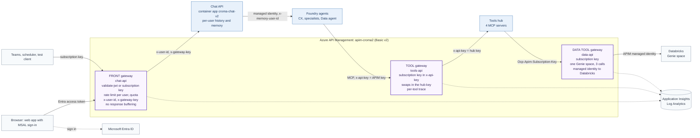
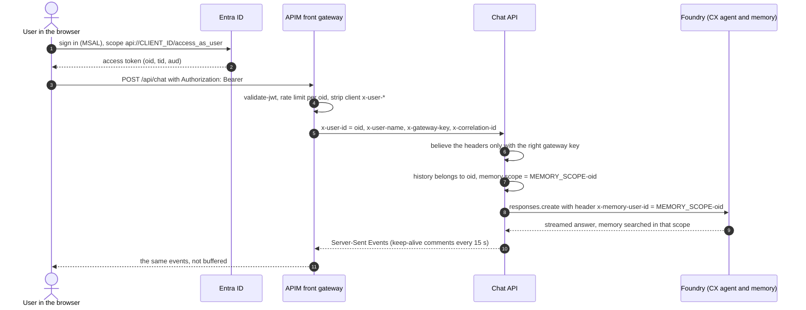

# Azure API Management for the Croma agentic system

Three gateways, built on Azure API Management (APIM) with Bicep, PowerShell and policy XML. Everything here is **optional**: without it the system runs exactly as
before (the chat UI talks to Foundry directly, the agents call the hub directly, the hub calls Databricks directly). With it, every path in and out is controlled,
authenticated, rate limited and logged in one place, which is the "two controlled doors" design point of [`architecture.md`](architecture.md).

| Gateway | Path | What it is for |
|---|---|---|
| **Front** | browser or channel, then APIM, then the **chat API** (a container app), then the Foundry CX agent | Sign-in (Entra ID token or subscription key), per-user identity, throttling and quotas, streaming, request logging |
| **Tool** | Foundry agents, then APIM, then the **hub** MCP endpoints | The hub's API key never leaves APIM, per-subscription limits, per-tool monitoring, only the four MCP paths are reachable |
| **Data tool** | the hub's Genie backend, then APIM, then **Databricks Genie** REST | APIM signs in to Databricks with its own managed identity, one Genie space only, an allow-list of three calls, limits |



The Data agent reaches data only through the hub's `query_space_croma_pricing` tool, so one data question crosses two gateways: Foundry to the hub through the **tool**
gateway, then the hub to Databricks through the **data tool** gateway.

## What is in the repository

| Path | What it is |
|---|---|
| `infra/apim/main.bicep`, `main.bicepparam` | The deployment. Parameters come from environment variables set by the deploy script, so no secret is ever on a command line or in a file |
| `infra/apim/modules/platform.bicep` | Log Analytics, Application Insights, the APIM instance (system-assigned identity), its Application Insights logger and the service-wide diagnostics |
| `infra/apim/modules/gateway.bicep` | Named values, backends, the three APIs with their operations (the allow-lists), policies, per-API diagnostics, products and subscriptions |
| `infra/apim/policies/*.xml` | The policies, one file each, loaded by Bicep with `loadTextContent` (limits are filled in from parameters) |
| `infra/apim/deploy_apim.ps1` | Builds and deploys the chat container, deploys the Bicep, writes `.apim.env` (URLs and subscription keys, git-ignored) |
| `infra/apim/create_entra_app.ps1` | Creates the Entra app registration for sign-in (and an optional test client) |
| `infra/apim/test_gateway.ps1` | The live checks, with PASS and FAIL output |
| `infra/apim/teardown.ps1` | Deletes everything (needs `-Yes`) |
| `infra/apim/try_data_gateway.py`, `probe_tool_gateway.py`, `probe_memory_scope.py` | Small live proofs: a Genie question through the data gateway, a Foundry agent calling the hub through the tool gateway, and per-user memory scopes |
| `tests/test_apim_policies.py`, `test_ui_identity.py`, `test_databricks_apim.py` | Offline tests: the Bicep and policies agree with each other and with the code they front (the data allow-list is compared with the requests the hub's backend really sends), the identity trust rules, and the `apim` auth mode |
| `ui/Dockerfile` | The chat app as one container: the React app is built in a Node stage, the FastAPI backend serves it and the API |
| `ui/backend/identity.py` | Who is calling and can that be believed (the gateway key), the correlation id echo |
| `ui/backend/store.py`, `main.py` | Conversation history and memory scope kept per user; keep-alive on the stream; per-user ownership checks |
| `ui/frontend/src/auth.ts` | Optional MSAL sign-in and `apiFetch`, active only when the app is built with `VITE_ENTRA_CLIENT_ID` |
| `hub/backends/databricks_genie.py`, `hub/settings.py` | The new `DATABRICKS_AUTH=apim` mode |
| `infra/create_hub_connection.ps1` | Can point the four Foundry connections at the tool gateway (`-Apim`) |

## Policies: what each does and why

Rules that apply to every API here: a policy never reads `context.Response.Body` (that buffers the whole response, which breaks Server-Sent Events and slows MCP
calls), and diagnostics log headers only, never a request or response body (`bytes: 0`, set per API so a service-wide change cannot turn it on).

### Front gateway: `chat-api`, base URL = the gateway URL

`policies/front-api.xml` runs on every operation, in this order:

1. **CORS.** Allows the gateway's own origin (the web app is served through it, so no CORS is needed) and any origin in `-CorsOrigins`. It comes first so a browser's preflight, which carries no credential, is answered before authentication.
2. **Strips `x-user-id`, `x-user-name` and `x-gateway-key`** from what the client sent. The chat API believes those headers, so only this policy may set them.
3. **Correlation id.** Keeps a well-formed client `x-correlation-id` (8 to 64 characters of letters, digits, `.`, `_`, `-`), otherwise uses the APIM request id. It is sent to the chat API and returned to the client.
4. **Authenticates the caller**, with one of:
   - an **Entra access token** in `Authorization: Bearer`, when the named value `jwt-enabled` is `true`. `validate-jwt` checks the signature against the tenant's keys, the audience (`entra-audience`, `entra-audience-alt`), the issuer (v2 `https://login.microsoftonline.com/<tenant>/v2.0` and v1 `https://sts.windows.net/<tenant>/`), expiry, and that the `tid` claim is your tenant. The issuer and tenant checks matter: Entra signs tokens for every tenant with the same keys, so without them a token from another tenant for the same audience would pass. The user id is the `oid` claim, the name `preferred_username`.
   - an **APIM subscription key** (`Ocp-Apim-Subscription-Key`). The user id is `sub-<subscription id>`: a channel, a scheduler or a test client is one identity.
   - neither: **401** with a JSON body.
   The API has `subscriptionRequired: false` on purpose, because the policy accepts either; a key that is present but invalid is still refused by APIM itself.
5. **Rate limit per user** (`rate-limit-by-key`, 120 calls a minute across the API by default). The counter key is the user id, so a busy user cannot use up another's share. Remaining calls come back in `x-ratelimit-remaining`.
6. **Tells the chat API who is calling**: `x-user-id`, `x-user-name` and `x-gateway-key` (from the secret named value `gateway-key`). The caller's own `Authorization` and subscription key are not forwarded.
7. **A trace** to Application Insights with the user id, the authentication mode and the correlation id as custom dimensions (table `AppTraces`, columns `Properties.user_id` and so on).
8. **`forward-request` with `buffer-response="false"`** and a timeout of 3600 seconds, so events reach the browser as they are produced. A redirect from the container (for example a trailing slash) is rewritten to a path, so the client never learns the container's address.

`policies/front-chat-turn.xml` on `POST /api/chat` adds a **stricter limit** (10 chat turns a minute per user by default; one call starts a model run that can take minutes) and, if `-ChatTurnsPerDay` is set, a **daily quota** per user (`quota-by-key`; once it is used up the caller gets `403 Quota Exceeded` with the time until it is replenished, tested with a quota of 3).

`policies/front-static.xml` on `GET /` and `GET /assets/*` (the web app's own files) deliberately **skips authentication**: the page must load before anyone has signed in. It only rate limits by client address and sends no gateway key. Only these two paths are open; everything the chat API serves that is not listed as an operation (for example `/docs` and `/openapi.json`) is a 404 at the gateway.

### Tool gateway: `tools-api`, base URL `<gateway>/tools`

Operations: `POST`, `GET`, `DELETE` on exactly `/genie/mcp`, `/agents/mcp`, `/context/mcp`, `/studio/mcp`. The hub's other routes (`/state`, `/trace`, `/events`, `/runs`, `/case`, `/report`, `/healthz`) are not operations, so they are 404 for this product.

The API's **subscription key header is `x-api-key`**, the header the existing Foundry Custom Keys connections already send, so a connection only needs its URL and key swapped. `policies/tools-api.xml`:

1. **Rate limit per subscription** (600 calls a minute by default).
2. **Records which tool was called.** It reads the JSON-RPC `method` and, for `tools/call`, the tool `name` from the **request** body (`preserveContent: true`, so the body still reaches the hub) and writes a trace with `mcp_method`, `mcp_tool`, `mcp_endpoint` and `subscription` as custom dimensions. That gives calls per tool without ever touching a response. (A trace metadata value must not be empty: a missing method or tool is recorded as `-`.)
3. **Swaps the key.** `x-api-key` is overwritten with the hub's real key from the secret named value `hub-api-key`. Foundry holds only an APIM key; the hub never sees it.
4. **Forwards** with `timeout="120"` (Foundry cuts a tool call at 100 seconds anyway) and no response buffering. A redirect from the hub is rewritten to a gateway path.

### Data tool gateway: `data-api`, base URL `<gateway>/dbx`

Operations, exactly what `hub/backends/databricks_genie.py` calls and nothing else:

| Call | Operation |
|---|---|
| `POST /api/2.0/genie/spaces/{space_id}/start-conversation` | ask a question |
| `GET  /api/2.0/genie/spaces/{space_id}/conversations/{conversation_id}/messages/{message_id}` | poll its status |
| `GET  .../messages/{message_id}/attachments/{attachment_id}/query-result` | read the rows |

`policies/data-api.xml`:

1. **Rate limit per subscription** (600 a minute: the backend polls a running question about every 1.5 seconds). `policies/data-start-conversation.xml` puts a stricter limit (30 new questions a minute) on starting a question; it is checked **before** the rest, so refused attempts count too.
2. **One Genie space only.** `space_id` must equal the named value `genie-space-id`, otherwise 403.
3. **`authentication-managed-identity`** for resource `2ff814a6-3304-4ab8-85cb-cd0e6f879c1d` (Azure Databricks): APIM's own identity signs in, so no Databricks credential exists outside APIM. The subscription key is removed before forwarding.

## Identity: from the sign-in to the memory scope



**The trust rule** (`ui/backend/identity.py`): with `GATEWAY_KEY` unset the chat API is the single-user app it always was (the identity headers are ignored). With it set, every `/api` request must carry that value in `x-gateway-key`, otherwise 401, so a request that reaches the container without passing the gateway cannot pretend to be someone; the user id must be present (401) and well-formed (400). Conversations are stored with their owner and every read, rename, delete and continue checks it (somebody else's conversation is a 404, not a 403, so its existence is not revealed). The interactive API docs are not served in this mode.

**Per-user memory has two halves.** The chat API's *Memory* tab (`/api/memory`) and its ownership checks use the scope `<MEMORY_SCOPE>-<user id>`. For the CX agent's own memory search to use the same scope, the agent must be deployed with its memory tool scope set to `{{$userId}}`, which makes Foundry take the scope from the `x-memory-user-id` header of each request (this is documented Foundry behaviour for a backend that calls on behalf of users). The chat API sends that header whenever there is a user. The switch is one environment variable when you deploy the agents:

```powershell
$env:MEMORY_TOOL_SCOPE = '{{$userId}}'      # default: the one shared MEMORY_SCOPE, as before
python -m agents.deploy_agents
```

`python infra/apim/probe_memory_scope.py` proves it: it saves a different fact for two scopes and shows the agent answering "teal" for one header, "orange" for the other and "unknown" with no header, then deletes everything it made.

## Run it

```powershell
# one-off: the Azure environment (see infra/config.example.ps1) and the hub's .env must exist
.\infra\apim\create_entra_app.ps1 -TestClient                 # optional: the Entra app registration (sign-in) and a test client
.\infra\apim\deploy_apim.ps1 -EnableJwt                       # builds the chat image, deploys the chat app and APIM; omit -EnableJwt for subscription keys only
.\infra\apim\test_gateway.ps1                                 # the live checks (-SkipChatTurn -SkipGenie for a free run; -LongStream adds the 5 minute keep-alive check)
.\infra\apim\teardown.ps1 -Yes                                # when you are finished
```

`deploy_apim.ps1` is idempotent: re-run it to ship a change. Useful switches: `-SkipChat` (only the gateways), `-SkipBuild`, `-WhatIf` (Bicep what-if), `-UpdatePlatform` (also re-apply the APIM instance itself), `-GrantDatabricks -WarehouseId <id> -Catalog <catalog>` (give APIM's identity access to the Genie space), `-DisableStreamCheck`, `-ShareHubEvents`, `-CorsOrigins`, and the limits (`-FrontCallsPerMinute`, `-ChatTurnsPerMinute`, `-ChatTurnsPerDay`, `-ToolsCallsPerMinute`, `-DataCallsPerMinute`, `-DataQuestionsPerMinute`). It creates only new resources: the resource group `rg-croma-v2`, the chat container app `croma-chat-v2` in your existing Container Apps environment, and role assignments for the chat app's new identity.

What it writes to `.apim.env` (git-ignored, secret): `APIM_FRONT_URL`, `APIM_TOOLS_URL`, `APIM_DATA_URL`, the three subscription keys, the chat app URL and gateway key, and the Entra ids. The scripts read it; nothing else needs it.

A first deployment takes about ten minutes (image build, container, APIM instance: a minute or so for Basic v2, then about five minutes for the gateway definitions); later runs that only change policies take about five. The chat app's settings:

| Environment variable on `croma-chat-v2` | Meaning |
|---|---|
| `FOUNDRY_PROJECT_ENDPOINT`, `HUB_URL`, `HUB_API_KEY` (secret) | As for the local UI: where the agents are, and the hub the chat API reads the case, report and event routes from. It calls the hub directly, not through the tool gateway (that gateway exposes only the MCP paths) |
| `NAME_PREFIX` | `croma2` for the side-by-side copy; sets the agent (`croma2-cx`), memory store and scope names |
| `GATEWAY_KEY` (secret) | The shared secret with the gateway; setting it switches the app to multi-user mode |
| `SSE_HEARTBEAT_S` | Seconds between keep-alive comment lines on the stream (the script sets 15; unset means none) |
| `ENABLE_STREAM_CHECK` | Serves the synthetic `/api/stream-check` stream that `test_gateway.ps1` uses (off unless set) |
| `SHARE_HUB_EVENTS` | Also show the hub's live event log (see Known limits) |
| `CX_AGENT`, `MEMORY_STORE`, `MEMORY_SCOPE`, `AGENT_MODEL`, `CHAT_DB_PATH` | Optional overrides. The deploy script forwards `CX_AGENT`, `MEMORY_STORE`, `MEMORY_SCOPE` and `AGENT_MODEL` if they are set in your shell |

## Entra ID sign-in for production

One app registration plays both parts: it is the **API** (it exposes the scope `access_as_user`; its application id is the audience APIM checks) and the **single-page app** (MSAL signs users in to it). `create_entra_app.ps1` does all of the following; by hand:

1. Microsoft Entra admin center, **App registrations**, **New registration**: name `croma2-chat`, **single tenant**, redirect URI of type **Single-page application** = the gateway URL (`https://<apim name>.azure-api.net`). Add `http://localhost:5173` for local development.
2. **Expose an API**: set the application id URI to `api://<client id>`, add a scope `access_as_user` (who can consent: admins and users).
3. **Manifest**: set `requestedAccessTokenVersion` to `2` (under `api`). Tokens then carry the application id as `aud` and the issuer `https://login.microsoftonline.com/<tenant>/v2.0`. The policy accepts both audience forms and both issuer forms.
4. **Authorized client applications**: add the app's own client id for the scope (users are not asked for consent), and, for tests only, the Azure CLI (`04b07795-8ddb-461a-bbee-02f9e1bf7b46`), so `az account get-access-token --scope api://<client id>/access_as_user` returns a token.
5. Deploy with the ids: `.\infra\apim\deploy_apim.ps1 -EnableJwt -EntraTenantId <tenant> -EntraAudience api://<client id> -EntraAudienceAlt <client id> -EntraClientId <client id>` (with the script's app registration the ids are read from `.apim.env`). `-EntraClientId` also builds the web app with sign-in switched on (`VITE_ENTRA_CLIENT_ID`, `VITE_ENTRA_TENANT_ID`, `VITE_API_SCOPE`); `jwt-enabled` is the switch inside APIM and can be flipped without a redeploy (portal, Named values).
6. Restrict who may sign in. By default any user in the tenant can. Either turn on **Assignment required** on the app's enterprise application and assign a group, or add a `required-claims` check for a group or app role to `validate-jwt` in `policies/front-api.xml`.

In the web app, `src/auth.ts` is **active only when `VITE_ENTRA_CLIENT_ID` is set at build time**. Then the page redirects to the Microsoft sign-in, MSAL keeps the tokens in session storage, and `apiFetch` (which replaced `fetch` in `src/api.ts`) adds `Authorization: Bearer` to every API call and renews the token silently. Without it `apiFetch` is a plain `fetch` and the MSAL library is not even in the bundle. For Teams, a channel that signs users in itself uses the same header; a bot or scheduler without a user can use a subscription key.

**Report files with sign-in on.** A browser cannot add a bearer header to a plain link or an `<iframe src>`, so `ReportCard.tsx` fetches `/api/report/...` with `apiFetch` and hands the browser a local blob URL (the Word download, the "New tab" link and the in-app viewer). With sign-in off these are ordinary links. Not yet tested in a signed-in browser session (see "Known limits").

## Switching the other two gateways on

**Foundry agents to the tool gateway.** Point the four project connections at APIM and store the APIM subscription key in them:

```powershell
.\infra\create_hub_connection.ps1 -Apim                  # the live connections now go through APIM (-Direct puts them back)
.\infra\create_hub_connection.ps1 -Apim -NamePrefix croma2-apimprobe   # or try it under other names first, next to the live ones
python infra\apim\probe_tool_gateway.py --server-url hub # a throwaway agent calls the hub's Genie tool through APIM
```

Agents already deployed need no change: Foundry calls the **connection's target**, not the `server_url` in the agent definition (verified: an agent whose tool still says the hub's URL reached the hub through APIM, with the APIM key, because its connection pointed at APIM). Setting `$Cfg.Apim.GatewayUrl` in `infra/config.ps1` makes `deploy_hub.ps1` do the same when it creates the connections.

**Hub to the data gateway.** In `infra/config.ps1` set `Genie.AuthMode = "apim"` and `Genie.DatabricksHost` to the data gateway URL (`APIM_DATA_URL`), give APIM's identity access once, and redeploy the hub (it stores the key as a secret):

```powershell
.\infra\apim\deploy_apim.ps1 -SkipChat -GrantDatabricks -WarehouseId <warehouse id> -Catalog <catalog>
.\infra\deploy_hub.ps1                                    # reads APIM_DATA_KEY from .apim.env
python infra\apim\try_data_gateway.py --space-id <space id>   # the hub's own backend, from your machine, through APIM
```

In this mode the hub sends `Ocp-Apim-Subscription-Key` and no `Authorization` header; `DATABRICKS_AUTH=managed_identity` and `token` are unchanged.

## Monitoring

Application Insights (`appi-croma2`) and Log Analytics (`law-croma2`) receive the gateway's request telemetry, the custom traces above and APIM's resource logs. Examples (Log Analytics):

```kusto
// who is calling the chat API, and how
AppTraces | where Properties.auth_mode != '' | summarize calls = count() by user = tostring(Properties.user_id), mode = tostring(Properties.auth_mode)

// calls per tool through the tool gateway
AppTraces | where Properties.mcp_tool != '' and Properties.mcp_tool != '-' | summarize calls = count() by tool = tostring(Properties.mcp_tool), endpoint = tostring(Properties.mcp_endpoint)

// failures and throttling by API
ApiManagementGatewayLogs | where ResponseCode >= 400 | summarize count() by ApiId, ResponseCode

// why a call failed inside a policy
ApiManagementGatewayLogs | where ResponseCode >= 500 | project TimeGenerated, ApiId, OperationId, LastErrorSource, LastErrorSection, LastErrorMessage
```

Telemetry arrives a few minutes after the call. The subscriptions have debug tracing turned off, so `ApiManagementGatewayLogs` is the way to find out why a policy failed.

## Cost and tiers

- **Basic v2 is billed by the hour while the instance exists**, whether or not it handles a call (plus a small amount for Log Analytics and Application Insights ingestion, and the chat container, which keeps one replica running). **Run `.\infra\apim\teardown.ps1 -Yes` when you are finished** (it deletes the resource group and the chat container app, purges the soft-deleted APIM name, and deletes the Entra app registrations and the Foundry probe connections; the one thing it cannot remove is the APIM service principal you added in Databricks). Check the current price for your region on the Azure pricing page before leaving it up.
- The v2 tiers (Basic v2, Standard v2, Premium v2) support everything used here: `validate-jwt`, `rate-limit-by-key`, `quota-by-key`, long-running connections for Server-Sent Events, managed identity authentication to a backend, and deployment from Bicep with API version 2024-05-01 or later. They provision in minutes (this instance took about a minute).
- **The Consumption tier does not suit this system**: Microsoft's documentation says long-running connections, which Server-Sent Events need, are supported in the classic and v2 tiers but not in Consumption, and `rate-limit-by-key` is not available there. The classic Developer, Basic and Standard tiers work but take much longer to provision (tens of minutes).
- Basic v2 has no virtual network integration; Standard v2 adds it (and private endpoints), which is the way to take the hub and the chat container off the public internet. The scripts take `-Sku StandardV2`.

## Known limits

- **Rate limits are approximate, and they are a token bucket.** The v2 tiers refill a bucket continuously (10 calls a minute is one token every six seconds), and Microsoft states that rate limiting is "never completely accurate". In the live test a burst of 25 calls against the 10 a minute chat limit let 11 through and refused 14 with `429` and a `Retry-After`; a slow trickle of about one call a second is refilled almost as fast as it is spent, so 14 to 15 calls got through before the first 429. Treat a limit as a throttle, not an exact quota (use `-ChatTurnsPerDay` for a daily cap, which has the same caveat).
- **Long turns and the four-minute idle timeout.** Azure load balancers, which APIM and the Container Apps ingress both use, cut a connection that is silent for about four minutes. The chat stream therefore sends a comment line (`: keepalive`) every 15 seconds (`SSE_HEARTBEAT_S`); the browser's event parser ignores it. `test_gateway.ps1 -LongStream` checks this with a stream that stays silent for 270 seconds: it lasted 271 seconds with 17 keep-alives through APIM and the ingress. A real report run of 30 minutes or more also depends on how long APIM and the ingress keep a single connection open: test with your longest turn before relying on it.
- **The hub's live event log is not kept per user**, so showing it to everyone would show one user's agent calls and SQL to another. Behind the gateway the chat API therefore leaves it out unless `SHARE_HUB_EVENTS` is set (fine for one user at a time, such as a demo). With it off, the admin view shows the CX agent and memory calls but not the specialists lighting up. Filtering the log by case is the way to bring it back for many users.
- **Cases and reports are not per user.** `/api/case/<id>`, `/api/runs/<id>` and `/api/report/...` are open to any signed-in caller who knows a case id (an unguessable-enough id, throttled by the gateway). Recording each case against the conversation that created it would close this.
- **Conversation history is a SQLite file in the container.** It is lost when the container is replaced, and the app must stay at one replica. A mounted volume (`CHAT_DB_PATH`) or Cosmos DB, keyed by the same user id, is the next step.
- **Report downloads and the report viewer need a different mechanism with sign-in on** (see above).
- **The chat container and the hub keep public ingress.** They are protected by the gateway key and the hub key; allow only APIM to reach them (Standard v2 with virtual network integration, or ingress restrictions) for production.
- **Genie answers vary from run to run.** The same question about total NMV for March 2026 returned 154.59 (the verified figure) and 150.73 through the same gateway, because the natural-language-to-SQL step sometimes adds a filter. The gateway does not change the answer.
- **APIM changes are slow.** Applying the gateway definitions takes about five minutes on Basic v2, and re-applying the instance itself longer; the deploy script does the latter only when the instance does not exist or `-UpdatePlatform` is given. `az` can lose track of a deployment on a flaky network while it carries on in Azure: the script then asks Azure for the real outcome.
- **A trace metadata value must not be empty**, or the gateway answers 500 (found the hard way; the policies substitute `-`).
- **Deleting APIM soft-deletes it** and reserves the name for 48 hours; `teardown.ps1` purges it so the name can be reused.
- **Not tested here:** the interactive MSAL sign-in in a real browser (the tokens, validation and every API call were tested with tokens from the Azure CLI and from a service principal), Teams, and a turn longer than about five minutes.
