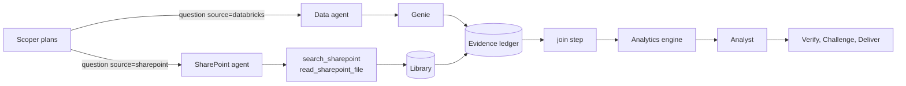

# SharePoint as a second data source

The Analysis and Research journeys can plan with two sources: the Databricks Genie data space, as before, and a SharePoint document library. The Scoper (the plan agent of the harnesses) decides, question by question, which source answers; the harness asks both in parallel, stores each answer in the same evidence ledger, and can join the two so the analytics engine computes on them together.

It is **off by default**. With `SHAREPOINT_BACKEND=off` (the default) nothing changes: the Scoper is not told SharePoint exists, and the system behaves exactly as v2.

## What it is for

The data space holds transactions, margin, markdown, stock and targets. People also keep things that are not in it: the promotion calendar, competitor price checks, store openings and closures, the markdown policy, the zonal managers' notes. Those often explain a movement that the data space can only show. Examples a plan can now use:

| Question | Databricks answers | SharePoint answers | How they combine |
|---|---|---|---|
| Did the August promotions explain the September dip in Laptops? | Weekly NMV for Laptops | The weekly planned discount rows from the promotion calendar | A `join` on the week, then a `trend` on the joined table |
| Is a competitor's price move behind the fall in Smart Phones? | NMV and units by week | The weekly price gap rows against Amazon | A `join` on the week; the Analyst reads the joined table |
| Which store changes could explain the zone shortfall? | NMV by zone, both months | The store change rows | An `aggregate` (count of closures and refits per zone), then a `join` on the zone |
| Did the promotion plan line up with the category movements? | NMV and units by category, both months | The weekly plan rows for every category | An `aggregate` (mean planned discount per category and month), then a `join` on the category |
| Was the discount within policy? | The discount depth by category | The policy's caps, as text | The Analyst quotes the cap; the number audit traces it to the passage |

## How a run works



1. **Plan.** The Scoper is told which sources are connected (`limits.sources`) and what the library holds (the `sharepoint` block of `config/data_profile.json`). Each question carries `source` (`databricks`, the default, or `sharepoint`) and, for SharePoint, `form`: `table` (rows a step can compute on) or `text` (passages the Analyst reads). A plan that uses a source that is not connected is sent back to the Scoper with the reason.
2. **Get data.** The harness asks every question of its source's agent, in parallel: the Data agent for Databricks, the **SharePoint agent** for files. Each answer is a result in the ledger with an id (R7), whichever source it came from.
3. **Aggregate, join and compute.** The SharePoint agent only reads: it never calculates, so a plan asks it for the file's *rows* (one row per week and category, one row per store change) and an `aggregate` step summarises them in code (count, sum, mean, min or max of a column, each over the rows that meet its own condition, grouped by a key; a key with no matching row gets a count of 0). A `join` step then puts one source's table beside the other's on a shared key (a week, a category, a zone): the other side must have one row per key. Later steps read the join by its step id. The analytics steps, the reconcile checks and the hypothesis rules work as before. A join or aggregate that names a column the file does not have goes back to the Scoper once, which sees the file's own headings.
4. **Conclude, verify, challenge.** The Analyst sees, for each SharePoint question, where the content came from (file, sheet, last modified date) and the content itself (the top rows, or the passages). The number audit counts a table's cells and the numbers written in a document's passages as evidence, so a figure quoted from a file is traced and a figure that is in neither the data nor the file is removed. The Critic is told to check that the file is the right one, is current, and is on the same basis as what it is compared with, and that a plan or forecast is not presented as an outcome.

If SharePoint fails but Databricks answers, the run goes on with what it has, and says what could not be checked. If neither answers, the run stops with the reason.

## The SharePoint agent and the tools

The **SharePoint agent** (`agents/prompts/sharepoint.md`) is the only agent that touches SharePoint, in the same way the Data agent is the only one that touches Genie. It has two MCP tools on the hub (`/sharepoint/mcp`):

| Tool | What it does |
|---|---|
| `search_sharepoint(query, conversation_id)` | Finds files in the connected library by keywords (an empty query lists the library). Returns each file's id, name, folder, last modified date and kind. |
| `read_sharepoint_file(file_id, sheet, focus, filter, conversation_id)` | Reads one file. A spreadsheet or CSV returns a table (`sheet` picks a sheet; `filter` keeps only the rows asked for, for example `category=Laptops; week_start>=2026-08-03`). A Word, PDF, PowerPoint or text file returns passages (`focus` picks the ones about a few keywords). Stored in the ledger; returns a `result_id`. |

What the connector does to a file before it reaches the ledger:

* a spreadsheet's title rows above the header are skipped; dates become `YYYY-MM-DD`; a percentage cell (shown as 12%) is returned as 12, with `%` added to its heading, so a value is never mistaken for 0.12;
* hidden sheets are left out; a sheet is capped at 200 rows (`SHAREPOINT_MAX_ROWS`), a document at 12 passages (`SHAREPOINT_MAX_PASSAGES`), a file at 25 MB;
* the file's own column headings are kept (the harness maps the Scoper's names onto them, and the Scoper gets one chance to re-point a step whose column is not there);
* the filter selects rows and nothing else: the agent does not compute.

A join refuses a SharePoint table with several rows per key (it would otherwise have to pick one silently): the Scoper is told to filter the question to one row per key, or to aggregate it first.

## Turning it on

SharePoint needs four things: a backend on the hub, a description of the library for the agents, the new agent and connection, and (for the real thing) access for the hub's identity.

1. **Describe the library.** In `config/data_profile.json` set `sharepoint.enabled` to `true` and list the files the analyses depend on, with their columns (`config/data_profile.example.json` shows the shape). This is what stops the Scoper asking SharePoint for what the data space has, and tells it which column names to expect.
2. **Choose the backend** in `infra/config.ps1` (`$Cfg.SharePoint`, see `config.example.ps1`) and re-deploy the hub:

   | Backend | Reads | Use it for |
   |---|---|---|
   | `graph` | One document library of a SharePoint site, through Microsoft Graph, with the hub's managed identity | The real library (set `SiteUrl`, and `Library` if it is not the site's default) |
   | `folder` | A folder bundled with the hub (`hub/sharepoint/sample_library`, or `SHAREPOINT_FOLDER`) as if it were a library | Trying the whole path on synthetic files, with no tenant access |
   | `off` | Nothing | The default |

   ```powershell
   .\infra\deploy_hub.ps1            # sets SHAREPOINT_BACKEND and the other SHAREPOINT_* settings, and creates the five project connections
   ```
3. **Deploy the agents** so the SharePoint agent exists and the Scoper, Analyst and Critic carry the new instructions: `python -m agents.deploy_agents`. (`--check` renders every prompt without calling Azure.)
4. **If the tool gateway is in use**, apply the gateway again (`.\infra\apim\deploy_apim.ps1 -SkipChat`): the tool gateway allow-lists the MCP paths, and `/sharepoint/mcp` is now one of five. Then point the new connection at it: `.\infra\create_hub_connection.ps1 -Apim`.

The chat app shows the SharePoint agent and library in the agent network when the hub reports a SharePoint backend, and lists each search and read, with the file, sheet and filter, in the activity log.

### Access to the real library (`graph`)

The hub reads SharePoint as **itself**, with its managed identity, and should be given the least access that works: the Microsoft Graph application role `Sites.Selected`, and then read access to the one site. Both steps need an administrator (the first a role that can grant application permissions, the second a site owner or an app with `Sites.FullControl.All`).

```powershell
$principal = az containerapp show -n <hub app> -g <resource group> --query identity.principalId -o tsv
$graph     = az ad sp show --id 00000003-0000-0000-c000-000000000000 --query id -o tsv
$role      = az ad sp show --id 00000003-0000-0000-c000-000000000000 --query "appRoles[?value=='Sites.Selected'].id | [0]" -o tsv
# 1. let the hub's identity use Sites.Selected (an administrator runs this)
az rest --method POST --uri "https://graph.microsoft.com/v1.0/servicePrincipals/$principal/appRoleAssignments" --body "{`"principalId`":`"$principal`",`"resourceId`":`"$graph`",`"appRoleId`":`"$role`"}"
# 2. grant it read access to the one site (the site's id comes from GET /sites/<host>:/sites/<name>)
$appId = az ad sp show --id $principal --query appId -o tsv
az rest --method POST --uri "https://graph.microsoft.com/v1.0/sites/<site id>/permissions" --body "{`"roles`":[`"read`"],`"grantedToIdentities`":[{`"application`":{`"id`":`"$appId`",`"displayName`":`"croma hub`"}}]}"
```

For a quick test from a laptop, `SHAREPOINT_AUTH=token` with `SHAREPOINT_TOKEN` set to a Graph access token (`az account get-access-token --resource https://graph.microsoft.com`) reads what the signed-in person can read.

> **Not yet proven against a real tenant.** The Graph backend is tested against a mocked transport (search, fetch, the error cases, the bearer token) and the whole path has been run end to end on the folder backend. It has not been run against a real SharePoint site, and the access commands above have not been run in the Croma tenant: expect small differences, and treat the error messages (which say whether access, the site or the file is the problem) as the first place to look.

## Settings

| Setting | Default | Meaning |
|---|---|---|
| `SHAREPOINT_BACKEND` | `off` | `graph`, `folder` or `off` |
| `SHAREPOINT_SITE_URL` | | `graph`: `https://<tenant>.sharepoint.com/sites/<site>` |
| `SHAREPOINT_LIBRARY` | the site's default library | `graph`: the document library to read |
| `SHAREPOINT_AUTH` | `managed_identity` | `managed_identity` (also a service principal through the usual environment variables, or `az login` on a laptop) or `token` |
| `SHAREPOINT_FOLDER` | the bundled sample library | `folder`: the directory to read |
| `SHAREPOINT_TOOL_DESCRIPTION` | | A sentence or two telling the SharePoint agent what the library holds |
| `SHAREPOINT_MAX_ROWS`, `SHAREPOINT_MAX_PASSAGES`, `SHAREPOINT_MAX_FILE_MB` | 200, 12, 25 | Limits on one read |
| `SHAREPOINT_MAX_CALLS_PER_CASE` | 120 | Tool calls per conversation |
| `SHAREPOINT_PARALLELISM` | 3 | SharePoint agent calls in flight at once (protects against Graph throttling) |
| `SHAREPOINT_TIMEOUT_S` | 60 | One Graph call (Foundry cuts a tool call at 100 seconds) |

## The sample library

`hub/sharepoint/sample_library` holds five invented files in four folders, made by `python hub/sharepoint/make_sample_library.py` so they can be regenerated and compared: a weekly promotion plan by category for 27 July to 12 October 2026 (with the Independence Day sale in early August, so a September dip has something to explain), a weekly competitor price gap, store openings, closures and refits, a markdown and promotion policy, and the zonal managers' September notes. None of it is Croma data.

## What the live runs showed

Run against the prototype (Databricks through the data gateway, the sample library through the folder backend, the real Foundry agents):

* **Analysis, "do the planned promotions line up with the weeks where Laptops sales were highest and lowest?"** The Scoper planned one Databricks question, one SharePoint question and a `join`; both sources answered in parallel (2 of 2), the join was made, every figure was traced, and the brief named the file and its modified date in its basis and said that a promotion plan is not a record of what ran. About two minutes.
* **Research, "why did Stores NMV fall in September, and was it the promotions ending, competitor prices or store closures?"** Five questions (two Databricks, three SharePoint), six join and aggregate tables, three hypotheses decided by rule, and a Critic that sent the first conclusion back with six issues (among them an aggregation that used only one competitor's rows, and a network aggregation that missed events), after which one follow-up round and a revision. About four minutes of hub time.

What went wrong first, and what changed because of it:

* The first Research run failed to test any SharePoint-backed explanation. The Scoper had asked the SharePoint agent for *calculated* figures (calendar-weighted means, counts per zone); the agent, correctly, only reads. The Scoper is now told that the SharePoint agent returns rows and never totals, and the new `aggregate` step does the arithmetic in code. A join or aggregate that names a column the file does not have also goes back to the Scoper once (it sees the file's own headings).
* Redeploying the API Management gateways for the new route exposed a bug in `deploy_apim.ps1`: it used `Genie.DatabricksHost` as the gateway's Databricks backend, which is the gateway's own URL once the hub uses it, so the gateway called itself and every Genie call returned a 401. `Apim.DatabricksUrl` now carries the workspace URL, and the script refuses an API Management address.

The quality of a plan still depends on the Scoper: the joins matched only the six categories the sample files cover (the brief said so in its caveats), and the Critic, not the plan, caught the one-competitor aggregation. Treat the runs as proof that the path works, not as a measure of how often a plan is right; that is the Evaluations workstream.

## What to know before relying on it

* **The hub reads as itself, not as the user.** Whatever the hub's identity can read, every user of the assistant can be shown. The Databricks path has the same property today. Passing the signed-in user's identity through (an on-behalf-of flow, so SharePoint's own permissions trim what each person sees) is the production answer, and is not built. Give the hub access to a library whose contents everyone who uses the assistant may see.
* **Document text is untrusted input.** A file can contain instructions aimed at a model. The SharePoint agent has read-only tools and no way to act, the Analyst has no tools, and the number audit removes any figure that is not in the evidence, but a passage can still try to steer the wording of an answer. Read access to a library that people outside the team can edit deserves a second look.
* **A file is a plan or a record kept by people.** It can be out of date, in a different period or on a different basis from the data space. The Analyst is told to say which file a figure came from and when it was last modified, and the Critic to challenge a plan presented as an outcome; both depend on the file's date being right.
* **What it reads.** One site and one library; spreadsheets, CSV, Word, PDF, PowerPoint and text files. Not SharePoint lists, pages, or files in other sites. A scanned PDF with no text layer returns nothing.
* **Only the two harnesses use it.** Lookup, Reporting and the report team still ask the Data agent only. Giving the report team the same source is a small step on the same pattern.
* **Graph goes straight from the hub.** The Databricks calls go through the data gateway; the Graph calls do not (there is no SharePoint gateway). Routing them through API Management, with its allow-list and traces, is a production step.
