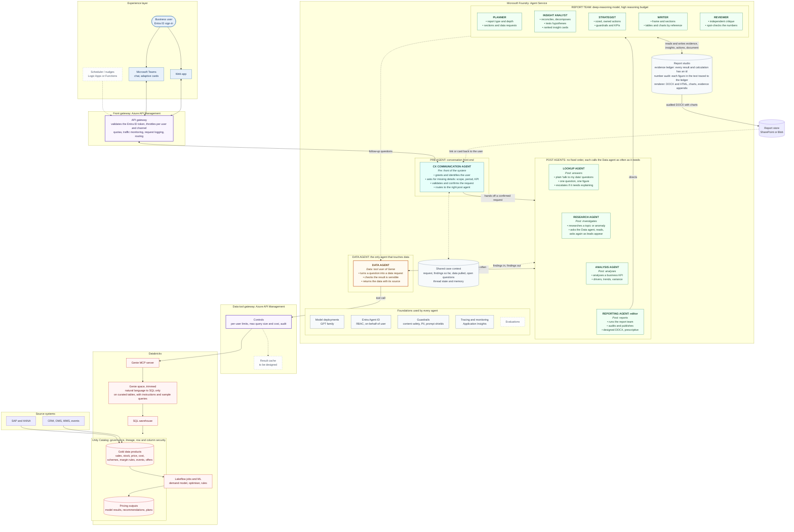
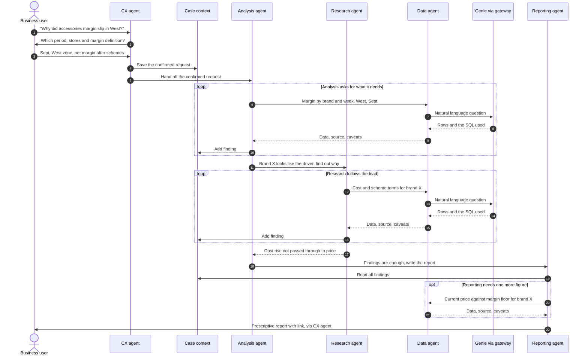

# Croma agentic profit planning and pricing: end-state flow

End state on Microsoft Foundry plus Databricks. The data layer is pluggable: the hub's data tool hands questions to a backend (a Databricks Genie space, your own function, or a stub), see `integrations/genie/README.md`. The diagram below shows the full target picture, including parts that are later phases.

Solid lines are in scope. Dashed lines and boxes are later phases or still to be designed.

## 1. End-state architecture

### How to read it

| Box | What it does | What it deliberately does not do |
|---|---|---|
| **CX agent** | Owns the conversation. Collects and confirms the right details before any analysis runs, then routes. It can also open a conversation from a nudge or a schedule later. | Query data or analyse anything itself. |
| **Data agent** | The single path to data. Frames the question for Genie, calls it as a tool when needed, sanity-checks the answer and returns it with its source. | Analyse, recommend or write reports. |
| **Lookup agent** | The fast path for plain questions such as "how many sales in March". No case, no confirmation round: it states the interpretation it used, asks the Data agent once and returns the figure. If the question needs explaining, it hands back to CX to route to Analysis. | Analyse, explain or compare drivers. |
| **Research and Analysis agents** | Do the thinking. Each decides at run time what data it needs and asks the Data agent, as many times as it takes. | Reach data except through the Data agent. |
| **Reporting agent (editor) and the report team** | The editor runs a small team on a deep-reasoning model: Planner (what the report should say and what evidence it needs), Insight analyst (reconcile, decompose, test explanations), Strategist (sized, owned actions), Writer (the document), Reviewer (independent critique). Each reads and writes a shared workspace; the editor decides when it is good enough and publishes. | Write a number that is not in the evidence ledger. |
| **Report studio** | Holds the evidence ledger (every data result and every calculation has an id), audits that each figure in the text traces to it, and renders the DOCX and HTML with charts and an evidence appendix. | Hold business logic or judgement. |
| **Shared case context** | Keeps the request, the findings so far and the data pulled, so Reporting can write from what Research and Analysis already established. | Store raw data extracts longer than needed. |
| **Front gateway** | The only way in for every channel, including scheduled nudges. Validates the Entra ID token, throttles and sets quotas per user and channel, monitors traffic and logs requests. | Hold conversation or business logic. |
| **Data tool gateway** | One controlled door to Databricks: per-user limits, a maximum query size or cost, audit, and later a result cache. | Hold business logic. |
| **Genie (trimmed)** | Natural language to SQL over curated Unity Catalog tables. | Run the pricing model, optimiser or rules. Those are Lakeflow jobs whose results land back in Unity Catalog as tables. |
| **Unity Catalog** | Governs the data: lineage, and row and column security applied for the signed-in user. | |

## 2. How a request flows

There is no fixed pipeline: after hand-off the post agents choose their own next step. This is one typical run.

## 3. Design points this diagram commits us to

1. **Two controlled doors.** Traffic from users and channels enters through the front gateway. Every data question goes agent, then Data agent, then the data tool gateway, then Genie. That is where limits, audit, caching and sanity checks sit.
2. **Genie stays thin.** The pricing model and optimiser run as Databricks jobs and publish tables. Genie only reads.
3. **Routing, not a script.** The CX agent hands over a confirmed request, and the post agents decide their own next steps.
4. **User identity travels with the call**, so Unity Catalog can apply the right row and column access for that person.
5. **Open design items** from the whiteboard: per-user controls and maximum query size or cost (gateway), data caching, best practice for consuming data, and the ML model. Evaluations is deferred.
